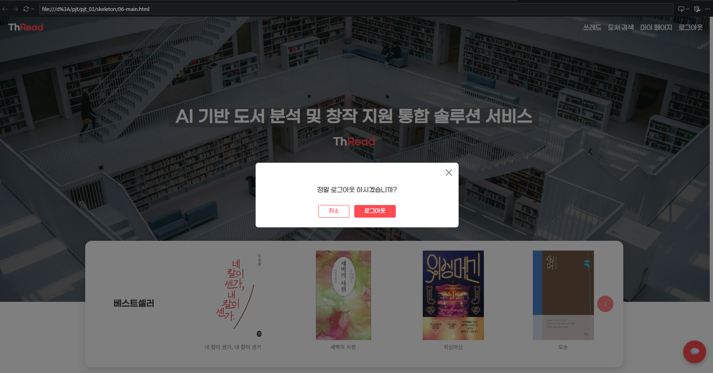

# ThRead - 도서 검색 챗봇과 반응형 웹

AI 도서 분석 서비스 ThRead의 메인·도서 상세 화면을 만들고, 보유 도서 100권을 검색해 답하는 챗봇 서버를 붙인 SSAFY 3회차 관통 프로젝트다. 과제 범위는 화면 구현이었고, 챗봇 서버와 위젯은 추가로 만들었다.

- 기간: 2026.10.15
- 인원: 개인
- 기술: Python, FastAPI, LangChain, ChromaDB, Ollama(Qwen3 4B) / HTML, CSS, Bootstrap 5, JavaScript



## 주요 기능

- 챗봇 API `POST /api/v1/chat`: 질문을 받아 답변과 함께, 답변에 나온 도서 정보를 화면용 카드 데이터로 돌려준다. `session_id`로 대화가 이어진다.
- 조건 검색과 주제 검색: "2022년 이후 소설"처럼 조건이 분명한 질문은 필터 도구로, "우주 SF 소설"처럼 막연한 질문은 하이브리드 검색 도구로 찾는다.
- 반응형 메인 화면: 베스트셀러 캐러셀, 장르 그리드, 인기 쓰레드
- 도서 상세 화면과 챗봇 위젯: 상세 화면에서 물어보면 보고 있는 책을 함께 서버로 보낸다.

서버 구조와 API 명세는 [261015-local-model/README.md](261015-local-model/README.md)에 정리했다.

## 고민한 점

### 챗봇이 책을 지어내는 문제

처음 만든 챗봇은 보유하지 않은 책 제목을 지어내거나, 있는 파이썬 책을 없다고 답했다. 몇 번 물어보고 감으로 판단하면 고쳤는지 알 수 없어서, 정답이 있는 질문 29개로 평가셋을 만들고 3번씩 돌려 채점했다. 처음 통과율은 72%였다.

검색이 부정확해서라고 생각하고 벡터 검색에 BM25 키워드 검색을 합쳤는데, 통과율이 오히려 64%로 떨어졌다(편차 범위 안). 실패한 답변을 다시 읽어 보니 대부분 모델이 검색 도구를 아예 부르지 않고 기억으로 답한 경우였다. 원인은 검색 품질이 아니었다.

그래서 시스템 프롬프트에 "도서 질문은 반드시 도구를 먼저 호출"을 넣고, 저자 이름 오타를 허용하고, "가장 비싼"은 정렬이고 "2만원 넘는"은 가격 하한이라는 식으로 도구 파라미터 설명을 구체적으로 고쳤다. 통과율은 90%, 97%로 올랐다. 도구 설명에 예시로 쓴 "2만원"을 모델이 그대로 따라 쓰는 일도 있어서, 작은 모델에게는 예시 하나도 조심해서 넣어야 한다는 걸 알게 됐다.

### 상세 화면을 Modal로 만들었다가 바꾼 이유

처음에는 상세 화면을 전체 화면 Modal로 띄웠다. 그런데 Bootstrap Modal은 열려 있는 동안 포커스를 안에 가두기 때문에, 그 위에 챗봇 창을 열면 입력창에 글자가 입력되지 않았다. 상세 화면을 별도 `<main>`으로 두고 URL hash(`#book-detail`)로 화면을 바꾸도록 고쳤다. 덕분에 새로고침하거나 링크를 공유해도 상세 화면이 그대로 열린다.

### 파일을 합치자 스타일이 깨지는 문제

단계별로 만든 HTML 파일을 하나로 합쳤더니 제목 크기가 바뀌고, 베스트셀러 아래 작은 캡션이 4rem으로 커졌다. 같은 `.book-title`을 한 파일에서는 캡션으로, 다른 파일에서는 상세 제목으로 쓰고 있었기 때문이다. 상세 제목을 `.detail-title`로 분리하고, 섹션마다 다른 스타일은 `.bestseller .section-title`처럼 범위를 좁혀 덮어쓰도록 정리했다.

## 실행 방법

```bash
cd 261015-local-model
ollama pull qwen3-embedding:4b
ollama pull qwen3:4b-instruct-2507-q4_K_M
pip install -r requirements.txt
python set_vector_store.py      # 벡터 DB 생성
uvicorn main:app --port 8000
```

서버를 켠 뒤 `skeleton/08-integrated.html`을 브라우저로 열고 오른쪽 아래 챗봇 버튼을 누른다.

## 배운 점

- 챗봇 성능은 감이 아니라 평가셋으로 개선 전후를 숫자로 비교해야 한다. 그래야 하이브리드 검색처럼 효과가 없는 작업을 바로 알아챌 수 있다.
- 작은 모델은 검색 품질보다 도구를 언제 부를지, 파라미터를 어떻게 채울지에서 더 많이 틀린다. 원인을 확인하기 전에 고치면 헛수고가 된다.
- API 응답에 화면이 바로 쓸 수 있는 데이터(도서 카드)를 같이 담아 두면 프론트 코드가 훨씬 단순해진다. 위젯을 직접 만들어 보면서 느꼈다.
- CSS 명시도와 Bootstrap 스타일을 덮어쓰는 방법, Flexbox와 Grid를 언제 쓰는지 정리할 수 있었다.

## 화면

챗봇까지 합친 동작 영상은 [08-integrated.mp4](스크린샷/08-integrated.mp4), 단계별 결과는 [스크린샷](스크린샷) 폴더에 있다.
